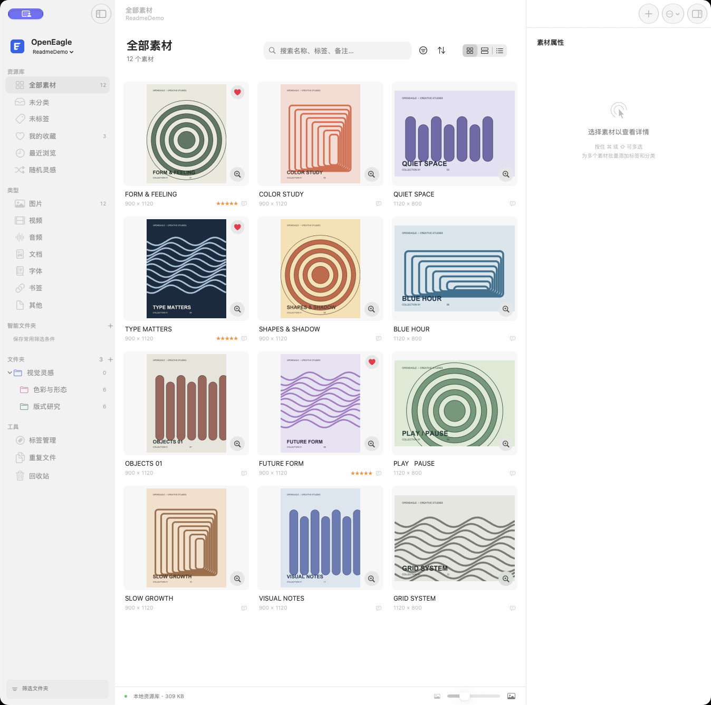
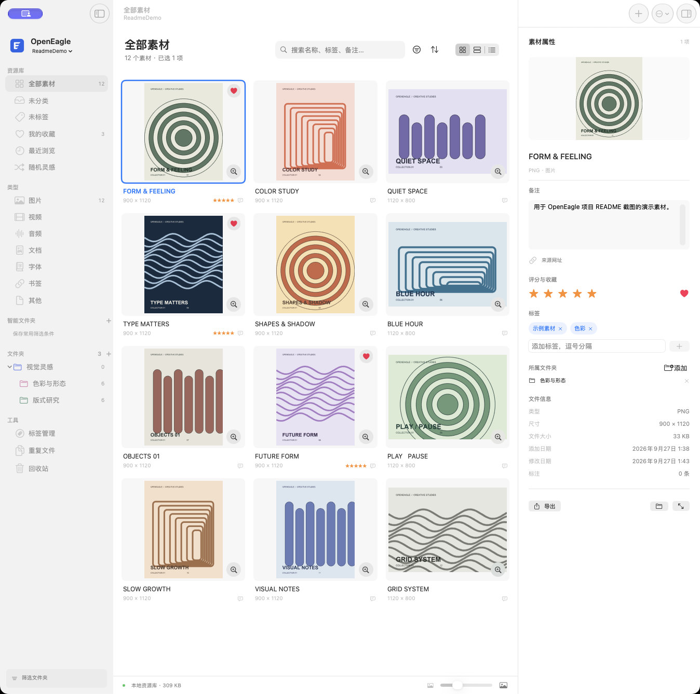

# OpenEagle

**一款本地优先的 macOS 素材管理器。** 把散落在文件夹、剪贴板和网页里的图片与其他文件收进资源库，用文件夹、标签、评分和搜索整理，再随时预览、导出或迁移。

OpenEagle 使用 SwiftUI / AppKit 构建，资源库保存在本机，无第三方运行依赖。项目独立实现，与 Eagle 官方无关联。



> 界面截图来自专门制作的 `ReadmeDemo` 演示资源库；其中的图片均为原创示例素材，不含个人文件。

| 素材属性与分类 | 主窗口内预览 |
| --- | --- |
| [](docs/screenshots/openeagle-detail.jpg) | [](docs/screenshots/openeagle-preview.jpg) |

## 功能

### 收集素材

- **文件与目录导入**：按 `⌘I` 选择文件或文件夹，也可以从 Finder 拖入。导入时复制原件，源文件仍留在原处；目录层级可转换为资源库里的逻辑文件夹。
- **重复内容识别**：按文件内容识别重复素材。默认跳过重复原件，并将可合并的标签与分类归属保留到已有素材；也可以在设置中允许导入重复文件。侧栏的“重复文件”视图用于检查和合并库内重复项。
- **随手采集**：支持从剪贴板导入文件或图片、截取屏幕区域，以及把网址保存为网页书签或下载链接指向的文件。
- **浏览器扩展**：在 Chrome / Edge 中筛选并批量保存页面图片，也可保存书签、当前可见页面截图，或通过图片右键菜单采集。扩展通过本机令牌连接 OpenEagle；启用步骤见[使用说明](docs/USER-GUIDE.md#浏览器采集)。
- **Eagle 资源库迁移**：只读打开 Eagle `.library`，复制可识别原件，并迁移文件夹层级、标签、备注、来源、星级和添加时间；不会修改源库。迁移范围和未转换内容见[迁移说明](docs/USER-GUIDE.md#资源库与迁移)。

### 整理与分类

- **资源库与文件夹**：可以新建、切换多个 `.openeagle` 资源库。文件夹支持多级嵌套、拖拽排序、颜色与图标、自动标签；一个素材可以归属多个文件夹。浏览父文件夹时，可选择是否包含所有子文件夹素材。
- **素材属性**：在右侧面板修改名称、备注、来源网址、标签、星级、收藏和所属文件夹。标签可以集中管理、合并和重命名；常用元数据编辑支持 `⌘Z` 撤销。
- **智能文件夹**：将搜索与筛选条件保存为智能文件夹，后续自动显示符合条件的素材，不重复复制原件。
- **文件夹锁定**：可为文件夹设置密码，锁定后从应用内浏览、搜索和本地接口隐藏该文件夹及下级素材。它是应用内访问保护，**不是原件加密**；原文件仍可通过 Finder 读取。

### 浏览、搜索与发现

- **多种视图**：网格、瀑布流和列表视图；侧栏按类型查看图片、视频、音频、文档、字体、书签及其他文件，也提供收藏、最近浏览和随机灵感入口。网格与瀑布流可用 `⌥ Option` + 滚轮调整缩略图大小。
- **组合搜索**：搜索名称、标签、备注、来源、OCR 识别文本和图片标注；以空格分开的多个关键词需要全部匹配。还可按类型、颜色类别、评分、尺寸、比例、文件大小和日期筛选。
- **相似与重复检查**：重复文件视图按内容查重；“查找相似图片”使用本机视觉特征比较图片，并按相似度列出结果。颜色筛选是便于浏览的颜色类别，并非专业色彩测量。

### 预览与批量处理

- **主窗口预览**：双击素材或按空格，在当前窗口打开预览，保留左侧导航与右侧属性；用方向键切换，按 `Esc` 返回原列表位置。也能用系统默认应用打开原件。
- **按类型预览**：图片支持缩放、滚轮调整和区域文字标注；视频与音频使用原生播放器，PDF 使用 PDFKit，字体可输入文字试排。其他格式交给 macOS Quick Look，实际效果取决于系统解码器与已安装扩展。
- **多选与批处理**：用 `⌘` / `⇧` 点击或在素材区拖出选框批量选择。可以批量添加标签、调整评分和文件夹、重命名、运行 OCR / 自动分类，或一起导出。

### 导出、备份与回收站

- **灵活导出**：导出原件，可选附带 JSON 元数据；静态位图可转换成 PNG、JPEG、TIFF，并在导出时缩放或顺时针旋转。重名文件会自动编号，原件不会因预览或转换而降质。
- **素材包与完整备份**：`.openeaglepack` 包含原件、文件夹层级、标签、评分、备注和图片标注，可导入其他 OpenEagle 资源库。完整备份复制一致的数据库与素材，生成可重新打开的资源库。
- **可恢复的删除**：素材先进入应用内回收站，可以恢复；清空回收站时，原件和元数据会移入 macOS 废纸篓。合并重复项产生的重复原件也会保留在回收站。

### 本地智能功能、扩展与自动化

- **Apple Vision**：在本机执行图片文字识别、英文分类标签生成和相似图片检索；识别出的文字可以搜索、复制。PDF 中可选中的文字也能提取。
- **本地多模态 AI**：下载 EmbeddingGemma 2 文字与视觉模型后，可用中文描述或图片检索图片、视频画面和文档，显示匹配页码与时间；后台索引可暂停、续建并增量更新。已有标签和文件夹可用于本地分类建议，预览后应用并支持撤销。见 [本地 AI 设置与验证](docs/LOCAL-AI.md)。
- **可选 AI 整理**：配置兼容 Chat Completions 的视觉接口后，可对选中的素材生成名称、标签和备注建议。只有主动点击生成时才发送该素材的缩略图与名称；API Key 存在 macOS 钥匙串。项目不附带付费模型服务。
- **自动导入文件夹**：应用运行期间定期检查指定目录，等复制中的文件静置后再导入；可取消任务。
- **本地接口与插件**：令牌保护的 API 仅监听 `127.0.0.1:41596`。仓库还提供仅依赖 Python 标准库的 [CLI / MCP 工具](docs/AUTOMATION.md)，以及基于 WKWebView 的本地 HTML 插件和内置“素材统计与清单导出”示例。

## 快速开始

**环境要求**：macOS 14 或更新版本、Xcode 与 Swift 6 工具链。目前在 Apple Silicon Mac 上验证；Intel Mac 尚未实测。当前仓库提供源码构建方式，应用未做面向公众分发的 Developer ID 签名与公证。

```sh
git clone https://github.com/Kevin-ho616/OpenEagle.git
cd OpenEagle
swift test
./script/build_and_run.sh --install
```

安装脚本会把应用放到 `~/Applications/OpenEagle.app`。如需先构建并验证启动，可运行 `./script/build_and_run.sh --verify`；`--release` 构建优化版本。

首次启动会创建 `~/Pictures/OpenEagle/我的资源库.openeagle`。打开应用后可以按下面的顺序体验：

1. 按 `⌘I` 导入几张图片，或从 Finder 拖入一个文件夹。
2. 在左侧创建文件夹，在右侧给素材添加标签、备注和评分。
3. 按 `⌘F` 搜索，再用筛选器缩小范围；常用条件可以保存成智能文件夹。
4. 双击或按空格预览，最后用 `⌘E` 导出原件或素材包。

| 常用操作 | 快捷键 |
| --- | --- |
| 导入文件 / 搜索 / 导出 | `⌘I` / `⌘F` / `⌘E` |
| 预览 / 返回列表 | `空格` / `Esc` |
| 从剪贴板导入 / 截取屏幕区域 | `⇧⌘V` / `⇧⌘S` |
| 切换资源库 / 快速切换 | `⌘O` / `⌘K` |
| 移入回收站 / 撤销编辑 | `⌘⌫` / `⌘Z` |

完整快捷键和逐步操作见[使用说明](docs/USER-GUIDE.md#快捷键)。

## 数据存放与使用边界

每个 `.openeagle` 资源库包含 `library.json`、`library.sqlite` 和 `assets/`。导入的原件复制进资源库，显示名称与磁盘上的存储文件名分离；SQLite 事务和文件原子移动保护导入过程。建议使用应用内“备份完整资源库”，或关闭应用后复制整个资源库目录。**不要让多个应用进程或多台设备同时写入同一个库。**

OpenEagle 可存储普通文件，但预览依赖 macOS 的解码能力与 Quick Look 扩展，不能保证所有 RAW、3D、Adobe 工程或视频编码都能在应用内完整显示。当前也不提供原件加密、云端协同、同步冲突合并或 Eagle Marketplace / 官方插件协议兼容。更多限制见[使用说明](docs/USER-GUIDE.md#当前边界)。

## 文档与开发

- [使用说明](docs/USER-GUIDE.md)：日常工作流、迁移、浏览器采集、智能功能与已知限制。
- [本地 API、CLI 与 MCP](docs/AUTOMATION.md)：接口、令牌、命令示例和插件协议。
- [Eagle 功能研究与验收契约](docs/EAGLE-RESEARCH.md)：产品范围与独立实现边界。
- [验收记录](docs/VERIFICATION.md)：现有自动化和手工验证记录。

核心库 `OpenEagleCore` 负责资源库事务、查询、迁移和元数据；macOS 应用负责视图、状态与系统集成。欢迎通过 Issue 反馈可复现的问题，或提交聚焦的 Pull Request。

代码采用 [MIT 许可证](LICENSE)。OpenEagle 是独立开源项目，与 Eagle 官方无关联。
